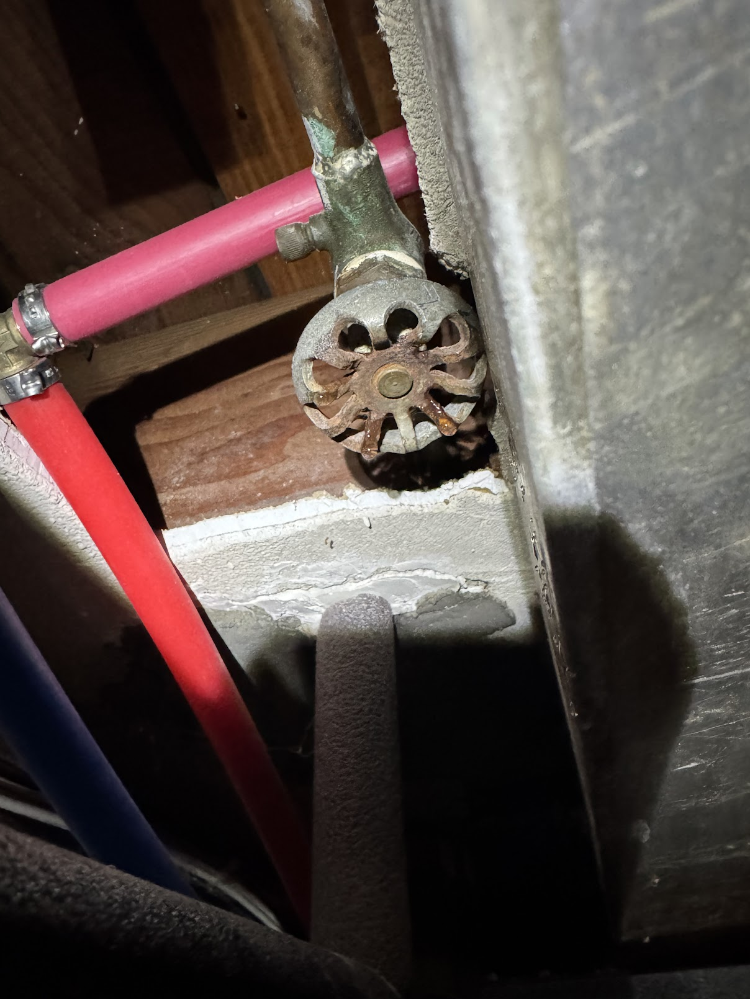
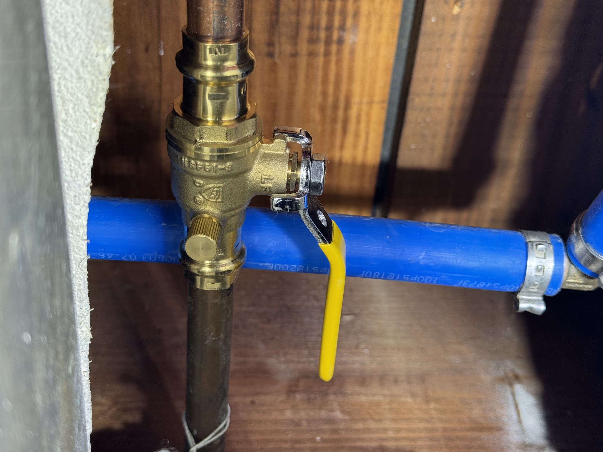

Потік відсікаючий кран у підвалі.
<!--more-->

Кран не головний - перекриває вихід води назовні будинку, поливати квіти, "garden hose".

На вигляд йому сто років, я його відкрив щоб скористатися виводом спереду будинку, а коли вирішив закрити - то із нього трошки закапало.

## Самостійний ремонт
Позаяк капало лише в відкритій позиції і капало через сам стержень крана - я спочатку думав що поміняти серединку я можу і сам. Викрутити стару, закрутити нову, та і по всьому. Однак кран у незручному місці - в стелі, трошки закис і я боявся зламати трубу у процесі.

Потім, як із допитливості розбирав уже кран на столі, то зусилля яке треба було щоб його відкрутити потребувалося колосальним. На столі відкрутив, але підключеним до системи імовірно не вдалося би без втрат.

## Американські сантехніки
Нагуглений сантехнік неподалік із хорошими відгуками попросив фото, запитав чи терміново, і через пару годин написав що може зайнятися через кілька днів - була субота, зробить у вівторок.

Сказав "ми можемо замінити той кран на новий відносно швидко за $300-$400".

Бля. Для крана який в цілому не тече і не те щоб дуже потрібен - забагато. Вивід води назовні є іще один позаду будинку і за 400 баксів можна і потягати шланг із одного краю дому до іншого.

## Українські сантехніки

Пообіцяв приїхати в суботу, але натомість приїхав у середу (що прекрасно), взяв $100 за роботу - відпиляти трубу із краном, поставити всі ті потрібні додаткові трубки і новий кран. 

Ми трошки забули злити воду із  системи (а кран же у підвалі), то наробили невелику калюжу, але зате новий кран на місці і працює прекрасно.

## Старий кран

## Новий кран
