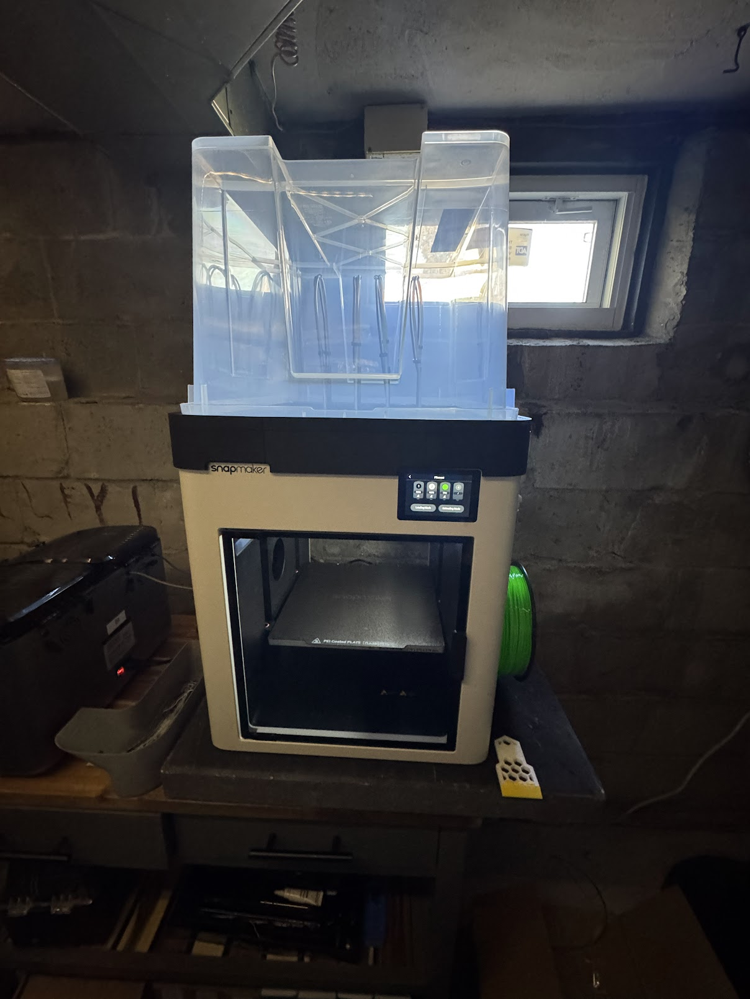
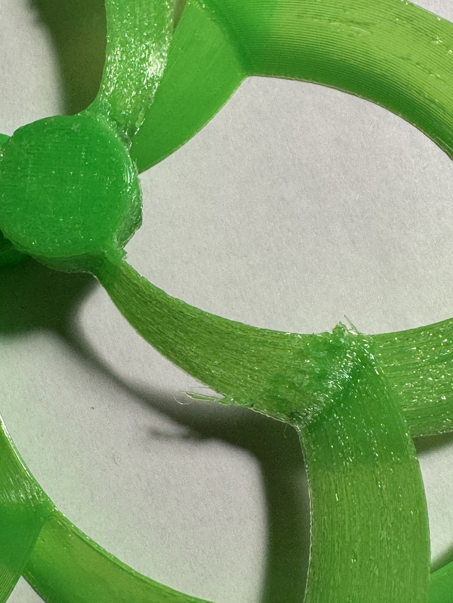
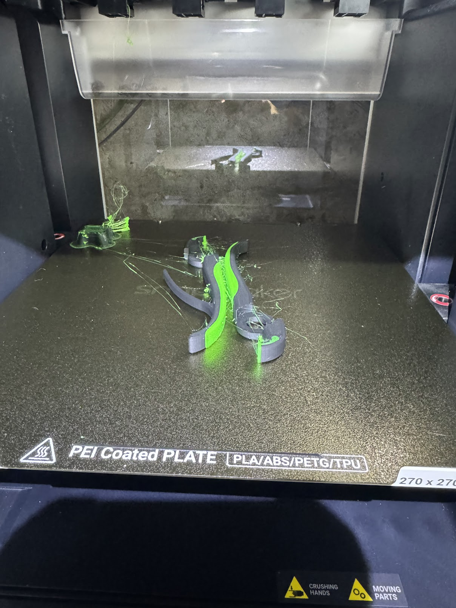
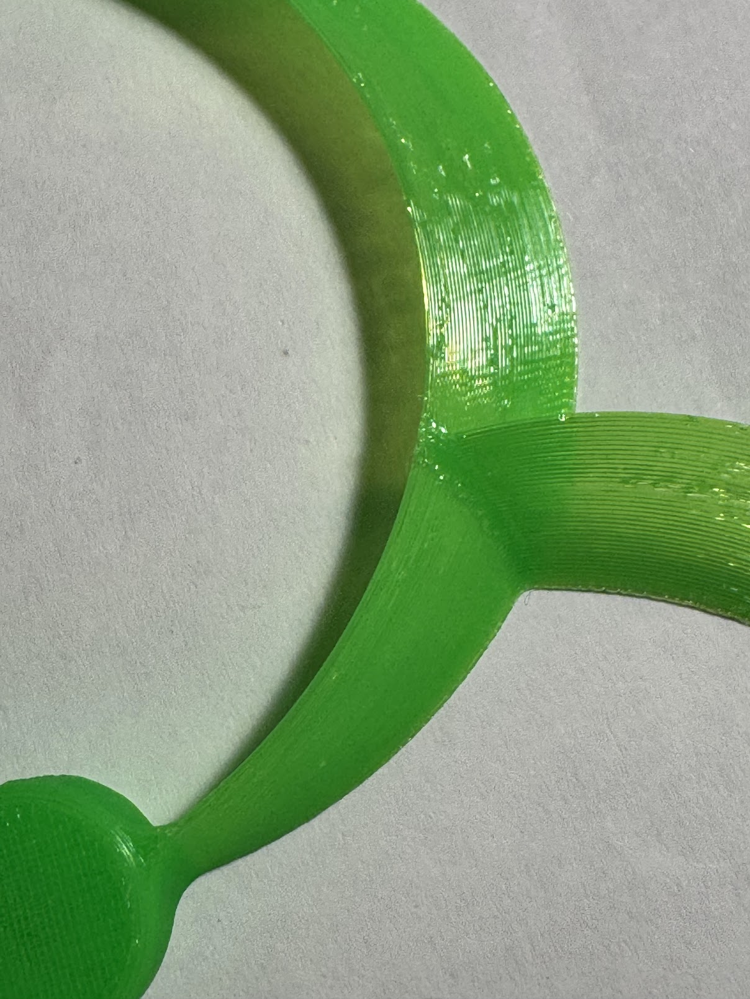
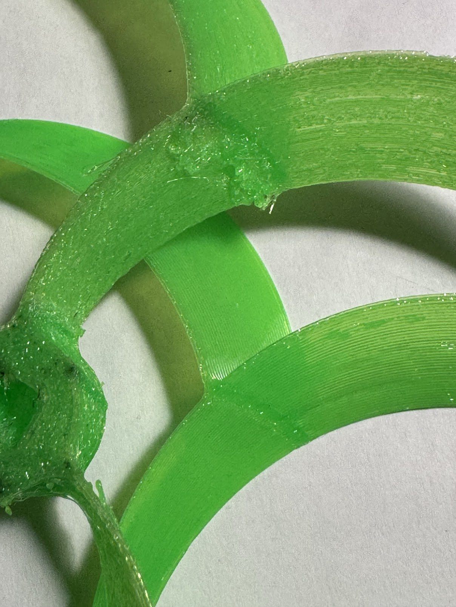
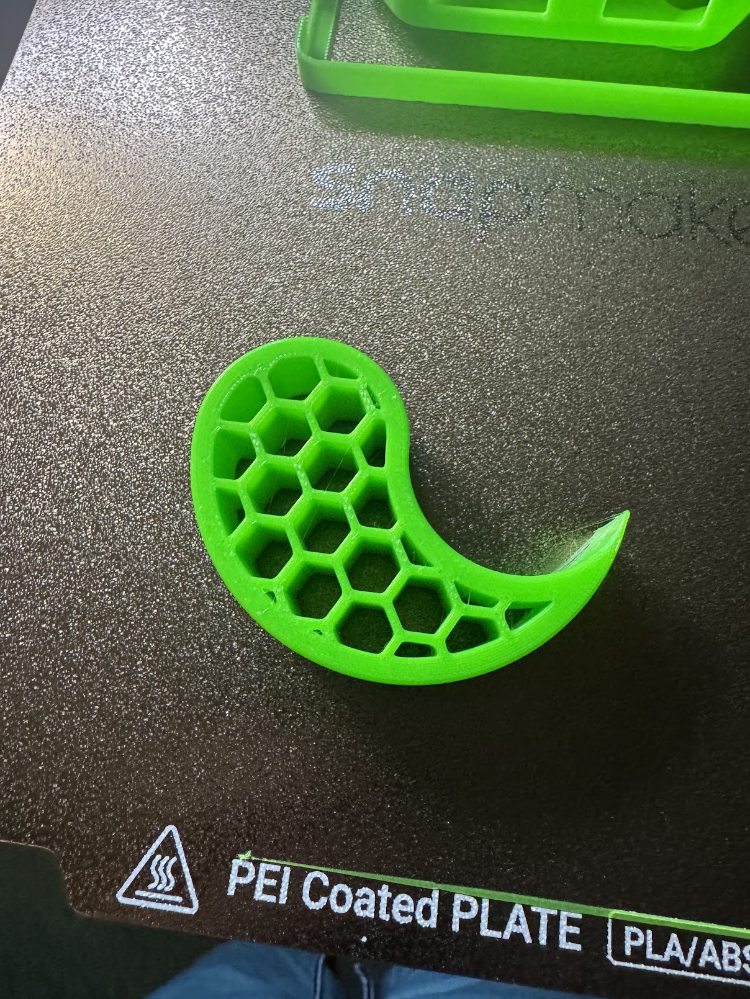
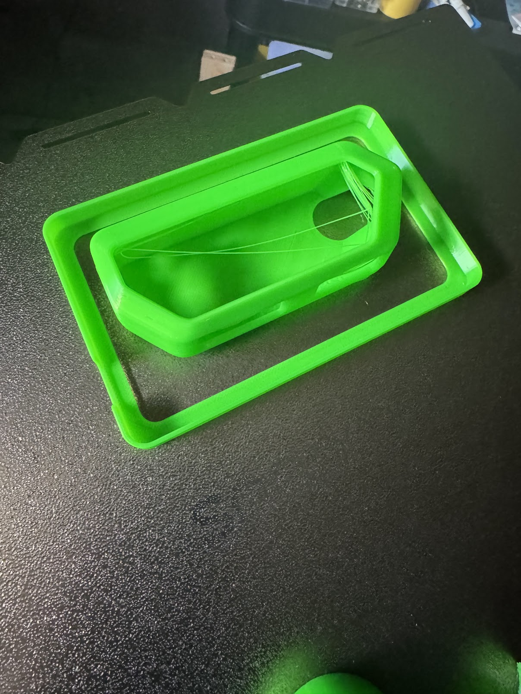
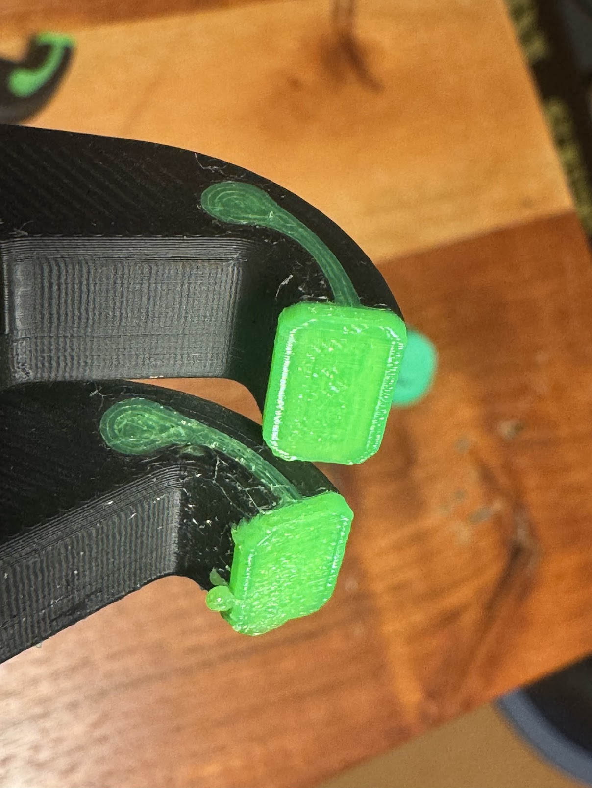

Дуже хотілося друкувати по-новому.
<!--more-->
## Роздуми про H2 серію
Бамбулаб понавипускала всяких крутецьких принтерів із подвійними чи навіть почетверними ноззлами - та ще і з лазерами!  
І із ціною Звізди смерті, на сьогодні найдорожчий Бамбулаб флагман `H2C Laser Full Combo` коштує $3150! Правда він включає 40-ваттний лазер і може різати тоненьке дерево і шось там ще, але ж при цьому і друкує 325х320х320 обʼєм!

Ок, без лазера можна купити за $2200 і це все одно дає змогу друкувати двома ноззлами, а значить - поєднувати суппорт (PETG+PLA) із меншою кількістю витрат пластику та часу, та і з мультикольором має бути теж краще!

Однак цього разу вмовити жабу на такий комбайн я не подужав. І так принтери стоять більшу частину часу без діла, і друкувати щось здоровенне не треба, і пластику щоб заощадити на 2к грошей то треба дуже довго друкувати.

## Роздуми про X2D

Тим часом на горизонті зʼявився більш доступний кандидат - X2D: буквально покращена версія X1C, ще і за суттєво менші гроші.

Вони позбулися карбонових направляючих на користь стальних, зате обзавелися другим ноззлом у голові, та й до того ж - швидкозмінним ноззлом, як у А1 серії (та P2S): тепер щоб змінити туди-сюди діаметр, не треба буде відкручувати нічого чи возюкатися із термопастою! Защолку відчикнув, ноззл відмагнітив, новий поставив, лєпота.

900 баксів за комбо із АМС v2 (а хто ж бере без АМС...)

Але при цьому друк одночасно тільки двома кольорами, а як треба більше - знову проблема відходів повертається. Другий ноззл самими Бамбу заявляється більше як можливість легкого друку суппорту аніж основного матеріалу, звертаючи увагу на зовнішній екструдер, що знижує якість друку.

## Рішення на користь U1

І отут навʼязлива фейсбучна реклама, що вже давно підсовувала мені Snapmaker U1 таки свого добилася. Він подешевшав (від 850 до 721) і доступний на амазоні - а це значить 5% кешбек! 

No-rush shipping додав ще +1 відсоток, то за ~$680 я отримав принтер-тулченджер із 4 головами, який може друкувати 4 кольорами послідовно і навіть якось (не пробував, але наче поки не дуже гарно) друкувати щось типу CMYK - повну палітру використовуючи 4 базові кольори.

Щоб було дешево і сердито, то замість офіційної накривушки за $150 я купив ікеївську за 7 (+доставка, +надрукувати перехідник) і вийшло таке собі коритце на голові у принтера.

Добрі люди підказали [посилання на пост на реддіті](https://www.reddit.com/r/SnapmakerU1/comments/1s3r0sn/my_u1_setup/#lightbox), тому сушарку я все-таки купив і два фідери трубками підключив - вийшла така собі майже АМС. 

Тільки згори її не поставиш, внизу не влазить, стоїть збоку і сприймається як тимчасове рішення, за відсутністю кращого. 
Буду думати куди і як переставити, а поки що із неочікуваних бонусів - перевідкрив для себе TPU !

## Трошки про TPU

Ним майже не користувався через складність впихання його повз АМС - треба чи відключати, чи городити якісь перехідники і тримачі (так і не доробив), тому друкував я лише на A1m і виходило паскудно:

### TPU на A1m

### TPU на U1
У U1 його запихати простіше, плюс є ж сушарка - подумав я - і отримав нічим не кращий результат на новому принтері і чотирирічній котушці філаменту. 

Навіть купив нову котушку іншого (імовірно кращого) філаменту, але поки його сушив то трошки погуглив-почитав, знайшов [готовий профіль для Бамбулаб](https://makerworld.com/en/models/1045337-the-perfect-tpu-profile?from=search#profileId-1031040) і спробував його в Снепмейкері.

Результат перевершив найкращі сподівання, тому ще наступних кілька днів я друкував із TPU все що тільки потрапляло на очі.

#### Накінечники пласкогубців із TPU - до і після

Замість зелених соплів, коз та ниток почало друкуватися щось нормальне і майже ідеальне. Тут вже не стільки заслуга нового принтера, скільки профіля - але він став драйвером.

Новий філамент так і не спробував, висушив і запакував назад у кульок до кращих часів - закінчилися ідеї, що друкувати із TPU...