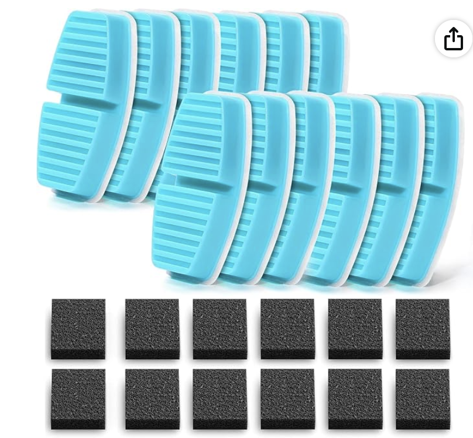
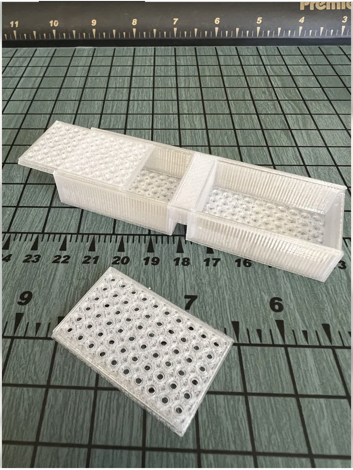
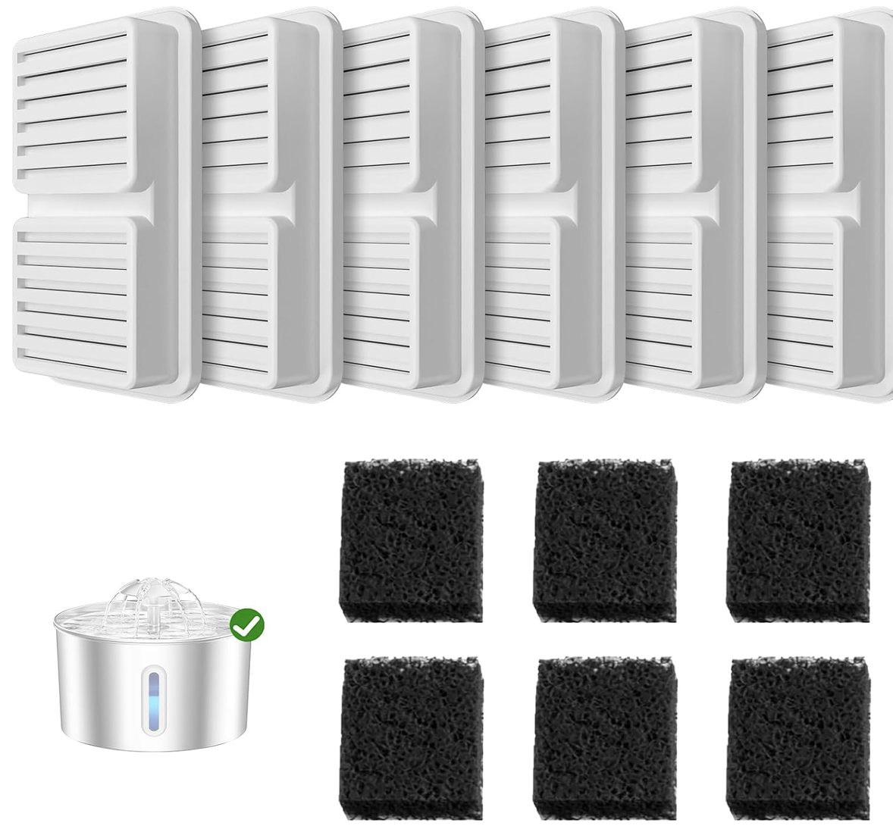
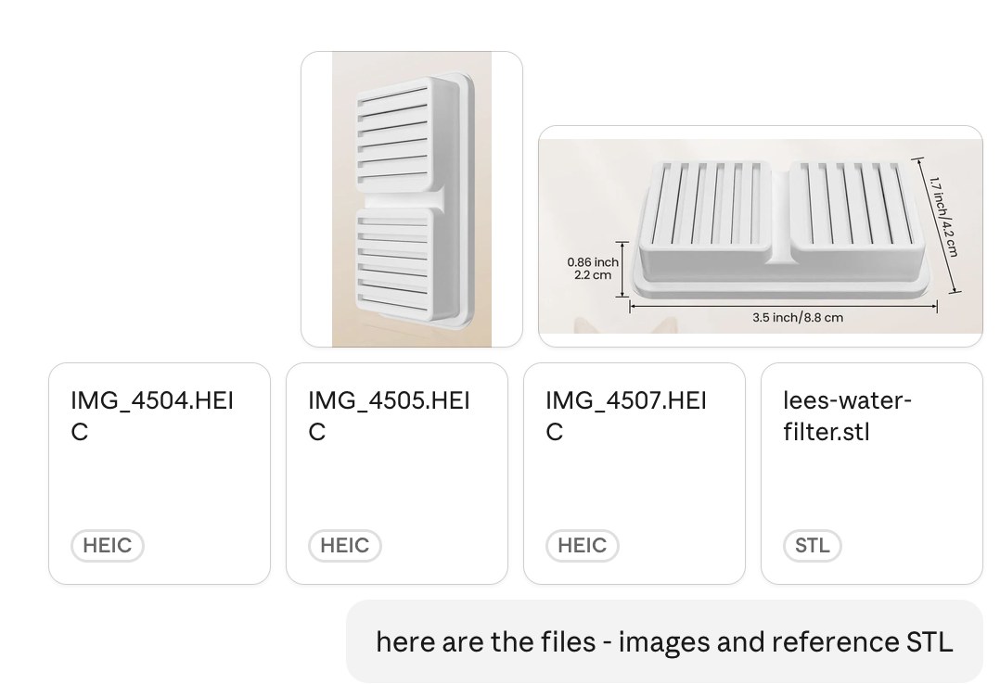
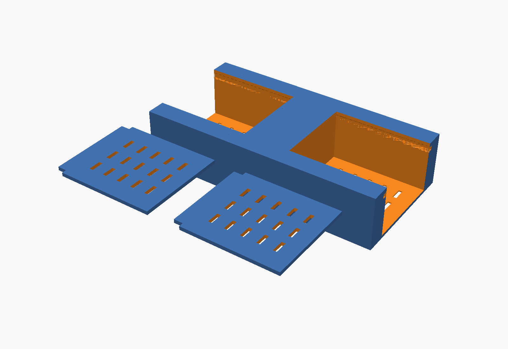
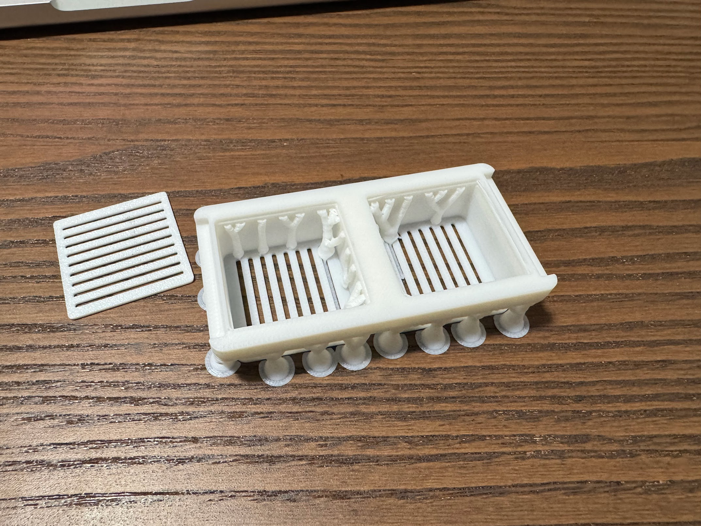
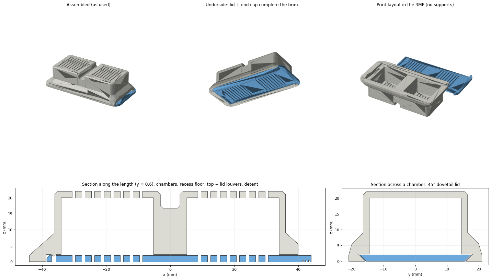
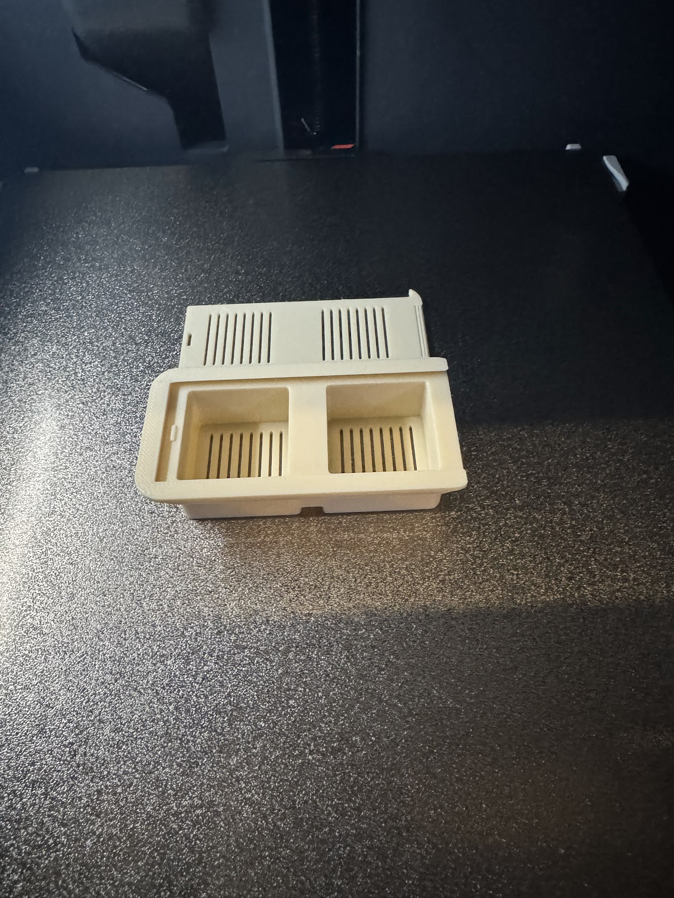
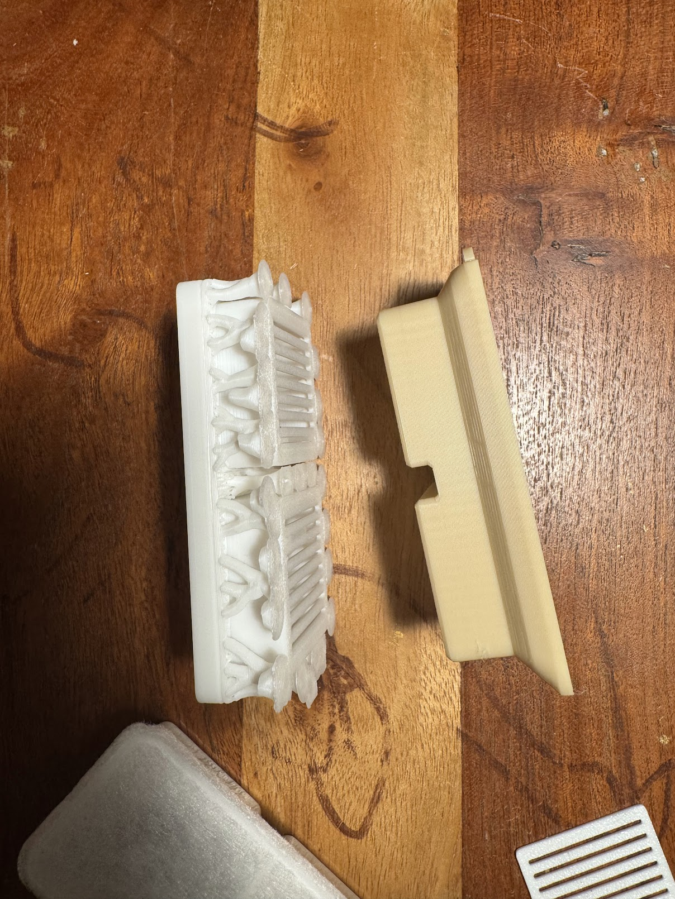
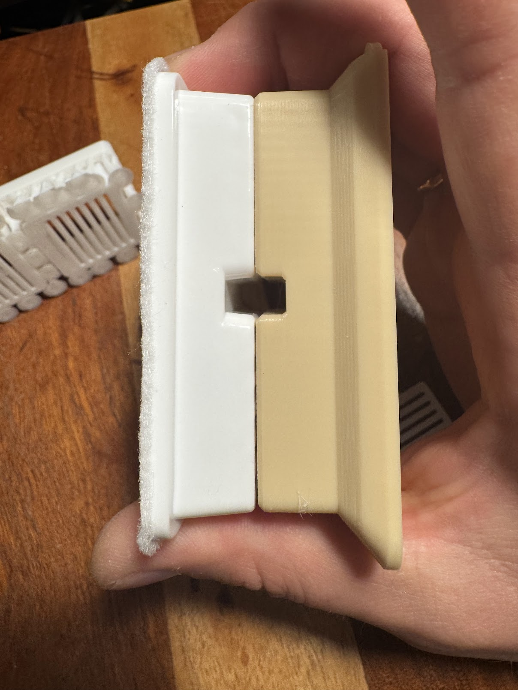

Водяний фільтр для кошачого питного фонтанчика коштує як водяний чип для сховища у Фолауті.
<!--more-->
## Фільтр
Ну ок, може не настільки багато - але 3 бакси за пластмасову коробочку ($16 за упаковку із 6ти) якось забагато.

У попереднього фонтанчика був інший фільтр і добрі люди зробили 3Д-модель: коробочку, в яку засипаєш вуглецевий порошок для якихось інших акваріумних фільтрів (банка 22 унції 12 баксів, вистачить на кілька років), коробочка ставиться у фонтанчик замість покупного фільтра.

Із мінусів - немає повстяного шару нагорі фільтра, який мабуть додатково щось фільтрує, але це 
- а) невелика біда
- б) ще може якось вирішимо

### Старий фільтр
Старий фільтр виглядав отак


А [3Д-модельований фільтр](https://www.printables.com/model/1043787-pet-water-fountain-filter-refillable-fofnon-brand) - отак


## Новий фільтр
Новий фільтр виглядає отак



## Дизайнимо із Клодом 4? 5?
В мене вже був позитивний досвід, коли Клод робив мені якісь модельки - я просив його написати програмку на [OpenSCAD](https://openscad.org/) і виходило щось більш-менш достойне.


У кінці червня 2026 року я закинув у Клод фото потрібного фільтру із розмірами і моделлю старого та попросив зробити мені щось отаке у OpenSCAD.


Пара днів і півдесятка ітерацій довели до того, що версія `0.5.4` у рендері клода виглядала отак



а насправді друкувалася отак


Купа супорту зовні і всередині, дуже неоптимально і страшно - хоча в цілому дещо функціонально.

Я трошки (липень-жовтень, 4 місяці?) покористувався, і спробував ще раз.

## Дизайнимо із Клодом Opus 5.5 Max

У тому самому чаті я вибрав навіть не останню модель (бо Fable вимагає додаткових грошей) і максимальний рівень зусиль.

Простим промптом
```
get back to my initial message and the next one with images.
design a 3MF file which fit the requirements.
you can make a single lid for both compartments.
Apply your best knowledge of 3D-printing design and modeling, try to avoid supports where possible.
```

за 5 годин (із яких скількись він сидів чекав поки я клікну "продовжити" бо скінчилися якісь там ресурси на запуск інструментів) він мені видав оновлену модель - 3MF файл і перероблену OpenSCAD програму - яка друкувалася без жодного суппорту і була на 4 мм вищою аніж треба - що вирішилося зміною одного параметра у OpenSCAD.
### Новий дизайн


### v0.6.0 і 0.5.4 поряд

### v0.6.0 і куплений фільтр


## Висновки
Прогрес за 4 місяці просто фантастичний.

Нам всім піздєц.